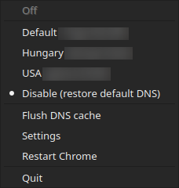
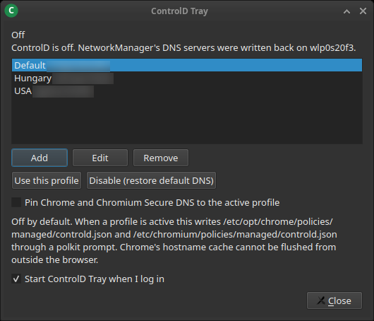
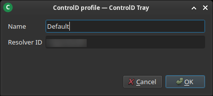

# ControlD Tray

Unofficial tray client for [Control D](https://controld.com). It switches premium resolver profiles on an Ubuntu laptop that uses NetworkManager and systemd-resolved, without editing config files by hand and without a root daemon.

The app runs as your user. Changing a link's DNS asks systemd-resolved over D-Bus. When the included polkit policy is installed, the app requests one temporary administrator authorization covering its DNS changes. An optional Chrome/Chromium Secure DNS policy goes through a small `pkexec` helper and can require a separate prompt.

## Screenshots

The tray menu. The checked item is the current choice. With no profile selected, that is **Disable (restore default DNS)**.



Settings lists the saved profiles and can switch or restore DNS when a tray host cannot show a menu.





## What it does

- Tray menu of saved profiles (display name + Control D resolver ID). The selected profile is checked. Left click and right click both open that menu. A click does not open Settings by itself; Settings is an item in the menu.
- **Disable (restore default DNS)** calls resolved's `RevertLink` on links this app has configured, then writes back the DNS servers, search domains, and default DNS route that NetworkManager still has for those devices.
- **Flush DNS cache** calls resolved's `FlushCaches`, then looks up Control D's verification name again when a profile is selected.
- **Settings** adds, edits, and removes profiles, and can activate the selected profile or restore default DNS. That keeps the app usable when a tray host cannot show a menu. Profiles are stored with `QSettings`.
- **Restart Chrome** asks confirmed browser processes to quit. Chrome's hostname cache cannot be cleared from outside the process.
- **Quit** leaves the current DNS settings in place.
- The tray icon and tooltip follow the last real result: active (the verification lookup matched), failed (a D-Bus call or the lookup failed), or off. A failed switch is not shown as active.

Resolver IDs are 1–64 ASCII letters or digits. Free-resolver hostnames and client names that contain `-` are rejected.

## Install

The Debian package is built on Ubuntu 24.04 against that release's Qt 6.4.2. Library dependencies are generated with `dpkg-shlibdeps`, so the package asks for noble's `libqt6*t64` names at the versions those libraries actually provide.

```bash
sudo apt install ./controld-tray_*_ubuntu24.04_amd64.deb
```

`controld-tray --version` prints `controld-tray 1.0.0`, the same version as the package. Ubuntu 22.04's distro Qt is 6.2, which is older than this program, so use the AppImage there.

The package installs:

- `/usr/bin/controld-tray`
- `/usr/libexec/controld-tray-chrome-policy` (or the configured `libexec` directory)
- Polkit actions `com.vzhitko.controldtray.configure-dns` and `com.vzhitko.controldtray.chrome-policy`
- `controld-tray.desktop` and a scalable icon

Launch **ControlD Tray** from the application menu. In Settings, **Start ControlD Tray when I log in** writes `~/.config/autostart/controld-tray.desktop`. That file is marked `X-ControlD-Tray-Autostart=true`, and the checkbox will not delete an autostart file it did not create.

### AppImage

GitHub Actions also builds `controld-tray-x86_64.AppImage` on Ubuntu 20.04 (glibc 2.31) and uploads it as a workflow artifact. A `v*` tag attaches that AppImage and the `.deb` to the GitHub release. Distributions with glibc 2.31 or newer can run the AppImage; that includes Ubuntu 20.04 and later.

```bash
chmod +x controld-tray-x86_64.AppImage
./controld-tray-x86_64.AppImage
```

On Ubuntu 22.04 and newer, install `libfuse2` if the kernel cannot mount the AppImage (`sudo apt install libfuse2`). `APPIMAGE_EXTRACT_AND_RUN=1 ./controld-tray-x86_64.AppImage` runs it without FUSE.

DNS switching does not install anything. It uses systemd-resolved's own polkit actions. The optional Chrome helper cannot live only inside the image: polkit will run a program only when that program is root-owned and named by a system policy file. The AppImage shows **Install helper** in the tray menu and in Settings. Nothing is written until you confirm. The confirmation lists every path. Polkit then asks to run the system `python3`, which copies only those files:

- `/usr/libexec/controld-tray-chrome-policy`
- `/usr/lib/controld-tray/` (the helper's private libraries, plus a manifest of their hashes). zlib and libcom-err stay on the system; they are part of the Ubuntu base and linuxdeploy does not bundle them. OpenSSL is not taken from the host.
- `/usr/share/polkit-1/actions/com.vzhitko.controldtray.policy`

**Uninstall helper** checks Debian package ownership as well as the manifest hashes, preserving a later `.deb` installation even when its policy file is byte-identical. If an unknown replacement changed the helper, its policy and private libraries are also preserved. If this AppImage wrote a managed Chrome policy, uninstall removes that policy first. DNS settings are not changed. If a helper is already installed and there is no AppImage manifest, the AppImage uses it and does not offer to replace it. Installation validates all staged files before writing, rolls back write failures, and records a recovery manifest before copying files. An interrupted or damaged managed installation retains Install and Uninstall options.

**Start ControlD Tray when I log in** writes the autostart entry's `Exec` to the AppImage file itself (not the temporary mount path) and copies the icon to `~/.local/share/icons/hicolor/256x256/apps/controld-tray.png`. Move the AppImage and turn the checkbox off and on again so the path is updated. Building the image locally uses `packaging/build-appimage.sh` with `QT_ROOT` pointing at a Qt 6.4 `gcc_64` prefix.

The first profile switch prompts for administrator authentication. The installed `configure-dns` action groups setting DNS servers, DNS-over-TLS, routing domains, default routing, and reverting the link under one temporary grant (`auth_admin_keep`). Polkit decides its lifetime and may prompt again after expiry, revocation, or a new session. This does not store your password or enable permanent passwordless access. Local administrator rules can override these defaults. Chrome pinning remains a separate privileged action.

To enable the reduced prompts, install the updated Debian package, or use **Install helper** / **Update helper** from the updated AppImage. Updating just the executable does not update the system authorization policy. With no grouped policy installed, DNS switching still works through resolved's separate prompts. An older helper owned by a Debian package must be updated through the package manager.

## Build

```bash
sudo apt install build-essential cmake ninja-build pkg-config \
    qt6-base-dev qt6-base-dev-tools libgl1-mesa-dev \
    clang-format clang-tidy dpkg-dev dbus python3
cmake -S . -B build -G Ninja -DCMAKE_BUILD_TYPE=Release
cmake --build build
ctest --test-dir build --output-on-failure
cpack -G DEB --config build/CPackConfig.cmake
```

The build uses `-Wall -Wextra -Wpedantic -Werror`. Tests do not need a desktop session; use `QT_QPA_PLATFORM=offscreen` when running the UI tests headlessly. The NetworkManager integration test uses a private `dbus-run-session`, and installer recovery tests use temporary directories. CI builds, tests, and packages the `.deb` on an Ubuntu 24.04 runner using only the distro Qt, then installs that package in a clean Ubuntu 24.04 container and runs `controld-tray --version`. The AppImage is built in an Ubuntu 20.04 container for older glibc.

## How it works

Profiles live in `~/.config/vzhitko/controld-tray/settings.ini` (mode `0600`). Settings are saved atomically, and save failures are reported. Cleanup intent is saved before changing system DNS or Chrome policies so a partial operation remains retryable after restarting the app. A cache flush cannot mark a selected profile active unless that profile was successfully applied in the current session.

Activating a profile on the NetworkManager primary connection:

1. `SetLinkDNSEx` on `org.freedesktop.resolve1.Manager` with Control D's premium anycast addresses, port `0`, and SNI `<resolver-id>.dns.controld.com`.
2. `SetLinkDNSOverTLS` with `yes`.
3. `SetLinkDomains` with the routing domain `~.` encoded the way `resolvectl` sends it: name `.` and the routing-only flag set.
4. `SetLinkDefaultRoute(true)`, matching systemd's privacy-DNS guidance so this link is a default DNS route.
5. `FlushCaches`.
6. `ResolveHostname("verify.controld.com")` with the DNS, no-search, and no-cache flags. The profile is shown as active only when the canonical name is `api.controld.com` and at least one address comes back.

Port `0` is the default. With DNS-over-TLS required, systemd-resolved connects to **853** (see `dns_transaction_port` in resolved). That matches Control D's `resolved.conf` example, which omits an explicit port.

Addresses and hostnames, from Control D's docs:

- [Control D IP ranges](https://docs.controld.com/docs/control-d-ip-ranges): premium Secure DNS bootstrap addresses for `dns.controld.com` are `76.76.2.22`, `76.76.10.22`, `2606:1a40::22`, and `2606:1a40:1::22`.
- [Linux](https://docs.controld.com/docs/linux-platform): `DNS=76.76.2.22#<resolver-id>.dns.controld.com` and `DNSOverTLS=yes`.
- [Device clients](https://docs.controld.com/docs/device-clients): DoH URL `https://dns.controld.com/<resolver-id>` and DoT hostname `<resolver-id>.dns.controld.com`.
- [Check if DNS is working](https://docs.controld.com/docs/check-if-dns-is-working): `verify.controld.com` is a CNAME for `api.controld.com` and does not resolve on other providers. The documented example address (`147.185.34.1`) is not treated as the only acceptable answer.

D-Bus calls set interactive authorization so the session polkit agent can prompt. Before a DNS mutation, the app checks its own system-bus-name subject with polkit using empty details. The installed `configure-dns` action uses `org.freedesktop.policykit.imply` to cover resolved's `org.freedesktop.resolve1.set-dns-servers`, `set-domains`, `set-default-route`, `set-dns-over-tls`, and `revert` actions ([polkit meta actions](https://www.freedesktop.org/software/polkit/docs/latest/polkit.8.html), [resolved D-Bus API](https://www.freedesktop.org/software/systemd/man/latest/org.freedesktop.resolve1.html)). Authorization denial stops the mutation, and the app does not cache authorization itself. Ubuntu 24.04's systemd 255 does not list a separate `flush-caches` action; the method is still called and a denial is shown as a failure.

NetworkManager's `PrimaryConnection` property and the primary connection's `StateChanged` signal are watched. A new primary link is configured and the previous link this app touched is reverted (`NoSuchLink` is ignored because the interface is already gone). A connection reaching the activated state, or a replacement connection on the same interface, reapplies the selected profile because NetworkManager writes its own DNS at that point. Quitting the tray does not revert DNS. On the next start, the saved profile is applied again.

`~.` is sent as domain `.` with routing-only true because that is what `resolvectl domain <iface> '~.'` puts on the bus (the `~` is the routing flag, and the name is the root).

### Chrome

Chrome's host resolver cache cannot be flushed by another process. The tray tells you that after a switch and offers **Restart Chrome**, which sends `SIGTERM` only to processes whose executable is still Chrome or Chromium after a second scan (so a recycled pid is not signaled).

Optional, off by default: pin Chrome's Secure DNS so it does not bypass the system profile. The helper writes only:

- `/etc/opt/chrome/policies/managed/controld.json`
- `/etc/chromium/policies/managed/controld.json`

```json
{
    "DnsOverHttpsMode": "secure",
    "DnsOverHttpsTemplates": "https://dns.controld.com/<resolver-id>"
}
```

Those are the [Chrome DnsOverHttpsMode](https://chromeenterprise.google/policies/#DnsOverHttpsMode) and [DnsOverHttpsTemplates](https://chromeenterprise.google/policies/#DnsOverHttpsTemplates) policies. `secure` does not fall back to plaintext DNS. The helper accepts `apply <resolver-id>` or `clear`, checks the id again, refuses symlinks, and will not follow a path outside those two files. `pkexec` is what makes it root; the tray itself stays unprivileged. The same policy is not rewritten on every reconnect when the resolver id is unchanged.

## Layout

- `ProfileStore` — QSettings persistence and validation
- `IResolvedBackend` / `SystemdResolvedBackend` — resolved D-Bus calls (the interface is what tests mock)
- `NetworkManagerWatcher` — primary connection and activation signals
- `PkexecChromePolicyWriter` — optional managed-policy helper
- `HelperInstallSession` — AppImage-only install and uninstall of that helper
- `ProfileController` — apply, revert, flush, and verification
- Tray menu, settings window, and profile editor

## Limitations

- **Chrome's hostname cache** cannot be flushed externally. Restart Chrome. A managed policy is also only guaranteed to be picked up at browser start.
- **NetworkManager can overwrite per-link DNS.** It calls the same resolved APIs when a connection is activated or reapplied. This app reapplies on primary-connection changes and on activation, but a later DNS push that does not emit those signals will stick until the next one. NetworkManager's `systemd-resolved` DNS plugin is the usual source of that push.
- **`RevertLink` clears per-link runtime DNS**, including servers NetworkManager had pushed. NetworkManager keeps those servers in the device IP configuration and does not send them again on `nmcli device reapply`, because that list did not change. Disable reads `NameserverData` (and the older `Nameservers` list for IPv4) and writes those servers back to systemd-resolved, including a default DNS route when the DNS priority is non-negative. A link NetworkManager no longer knows about stays without per-link DNS until that connection is activated again.
- **`~.` is not an exclusive claim** if another link is also a default DNS route. systemd routes a query to every link whose routing domain matches ([resolved discussion](https://github.com/systemd/systemd/issues/9472)). This app sets the primary link only.
- **`ctrld` is not used.** Control D's command-line daemon is the vendor's supported Linux client. This program talks to systemd-resolved directly so profiles can change without that daemon.
- A link owned by systemd-networkd can return `org.freedesktop.resolve1.LinkBusy`. The error is shown; DNS is left unchanged.
- The Chrome helper has to be root-owned and not group/world-writable, which is true after the package install or **Install helper**. Running the binary out of a build directory can switch DNS, but the Chrome option reports that `pkexec` would refuse the helper. An AppImage does not install the helper until you confirm that action. The polkit dialog names `python3` because that is the root-owned program that copies the listed files.
- **Install helper needs `/usr/bin/python3`**, which Ubuntu provides. The helper binary from the AppImage is linked against the Qt libraries shipped beside it, so those libraries are part of the install list. zlib (`libz.so.1`) and `libcom_err.so.2` are the host libraries that copy leaves in place. The `.deb` helper uses the system's Qt instead and does not need `/usr/lib/controld-tray`.
- There is no separate "applying" icon. The icon changes when the D-Bus calls and the verification lookup have finished.
